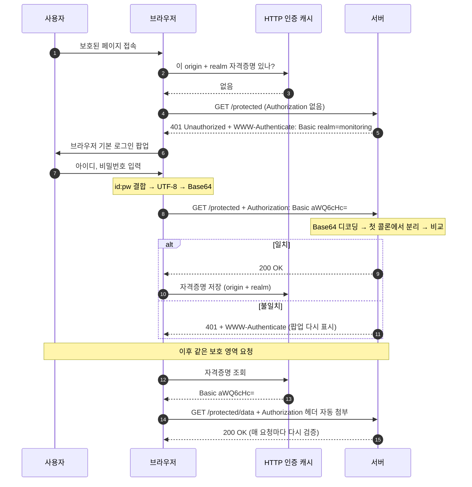
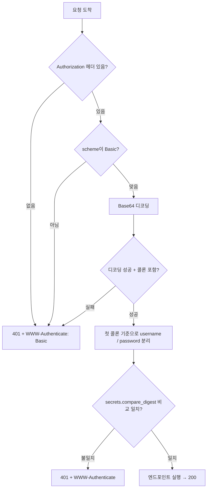

# HTTP Basic Auth

## 1. 개요

- HTTP 표준 인증 프레임워크(RFC 9110 §11) 위에서 동작하는 인증 scheme 중 하나임
- 세부 규격은 RFC 7617
- 아이디와 비밀번호를 매 요청마다 `Authorization` 헤더에 실어 보내는 방식임
- 서버는 세션을 만들지 않음. 요청이 올 때마다 헤더를 새로 검증함 (stateless)

## 2. 동작 흐름



### 2-1. 인증 없이 첫 요청

```http
GET /protected HTTP/1.1
Host: example.com
```

### 2-2. 서버의 401 응답

```http
HTTP/1.1 401 Unauthorized
WWW-Authenticate: Basic realm="monitoring", charset="UTF-8"
```

- `WWW-Authenticate` 헤더가 "Basic 방식으로 인증하라"는 신호임
- `realm`: 보호 영역의 이름. 같은 서버 안에서도 realm이 다르면 다른 자격증명을 쓸 수 있음
- `charset="UTF-8"`: RFC 7617에서 추가된 파라미터. 없으면 아이디/비번의 문자 인코딩이 정의되지 않음 (과거에는 ISO-8859-1로 처리하는 구현이 많았음)
- 브라우저는 이 헤더를 보고 기본 로그인 팝업을 띄움. 이 헤더 없이 401만 오면 팝업이 뜨지 않음

### 2-3. 자격증명 생성 후 재요청

1. 입력값을 `아이디:비밀번호` 형태로 결합함
2. UTF-8 바이트로 변환함
3. Base64로 인코딩함
4. `Authorization: Basic <인코딩 값>` 헤더로 전송함

```http
GET /protected HTTP/1.1
Authorization: Basic aWQ6cHc=
```

- `aWQ6cHc=`는 `id:pw`를 인코딩한 예시 값임

### 2-4. 서버 검증

- Base64를 디코딩한 뒤 첫 번째 콜론을 기준으로 아이디와 비밀번호를 분리함
- 그래서 아이디에는 콜론을 쓸 수 없고, 비밀번호에는 쓸 수 있음
- 일치하면 200, 불일치하면 다시 401 + `WWW-Authenticate`를 반환함

## 3. 서버 측 판단 순서



## 4. HTTP 인증 캐시

### 4-1. 저장 위치

- 브라우저의 네트워크 처리 계층이 자체적으로 보관하는 내부 캐시임 (Chromium 소스에서는 `HttpAuthCache`)
- 표준에 정해진 공식 명칭은 없음
- 인증 성공 후 (origin + realm) 단위로 메모리에 저장함
- 웹 페이지에 노출되는 저장소가 아님
  - JS로 읽을 수 없음
  - 개발자도구 Application 탭(쿠키, localStorage, sessionStorage)에 표시되지 않음
  - Network 탭의 요청 헤더에서만 `Authorization: Basic ...` 형태로 확인 가능함

### 4-2. 웹 저장소와 비교

| 구분 | 쿠키 | localStorage / sessionStorage | HTTP 인증 캐시 |
|---|---|---|---|
| 생성 주체 | 서버(`Set-Cookie`) 또는 JS | JS | 브라우저(401 응답 + 사용자 입력) |
| Application 탭 | 표시됨 | 표시됨 | 표시 안 됨 |
| JS 접근 | 가능 (HttpOnly 제외) | 가능 | 불가 |
| 요청에 자동 첨부 | `Cookie` 헤더 | 첨부 안 됨 | `Authorization` 헤더 |
| 수명 | 만료일 설정에 따름 | 영구 / 탭 종료 시 삭제 | 보통 브라우저 프로세스 종료 시까지 |

### 4-3. 첨부 범위

- RFC 7617상 클라이언트는 401을 받았던 URL 경로와 그 하위 경로를 같은 보호 영역으로 간주하고 자격증명을 선제적으로 첨부할 수 있음
- 같은 origin이라도 realm이 다르면 별도 자격증명으로 취급함

### 4-4. 수명

- 탭/창 단위가 아니라 브라우저 프로세스 단위로 유지됨. 탭을 닫아도 창이 하나라도 열려 있으면 남아 있음
- Windows Chrome은 창을 모두 닫아도 백그라운드 실행 설정이 켜져 있으면 프로세스가 유지되어 캐시도 남음
- 표준 로그아웃 방법이 없음
- 팝업에서 "비밀번호 저장"을 선택했다면 비밀번호 관리자(`chrome://password-manager`)에도 별도로 저장됨. 캐시가 지워져도 팝업에 값이 자동 입력됨

### 4-5. 확인 방법

- 시크릿 창으로 같은 URL 접속 → 캐시가 없으므로 로그인 팝업이 다시 뜸
- 캐시 삭제의 가장 확실한 방법은 브라우저 완전 종료 (백그라운드 실행 포함)

## 5. 클라이언트별 동작

| 클라이언트 | 동작 |
|---|---|
| 브라우저 | 401을 먼저 받은 뒤 팝업 → 이후 자동 첨부 |
| Python `requests.get(url, auth=(id, pw))` | 첫 요청부터 헤더를 붙임 (선제 전송), 401 왕복 없음 |
| `curl -u id:pw URL` | 위와 동일 |
| `https://id:pw@host/...` | URL에 직접 포함하는 방식. 최신 브라우저는 대부분 차단하거나 경고함 |

- 쿠키를 찾아 스크립트에 넣는 방식으로는 인증이 되지 않음. Basic 인증은 쿠키를 쓰지 않기 때문임

## 6. FastAPI `HTTPBasic` 구현 예시

```python
import os
import secrets

from fastapi import Depends, FastAPI, HTTPException, status
from fastapi.security import HTTPBasic, HTTPBasicCredentials

app = FastAPI()
security = HTTPBasic(realm="monitoring")

OPERATOR_USER = os.environ["OPERATOR_USER"].encode()
OPERATOR_PASS = os.environ["OPERATOR_PASS"].encode()


def verify_operator(credentials: HTTPBasicCredentials = Depends(security)) -> str:
    user_ok = secrets.compare_digest(credentials.username.encode(), OPERATOR_USER)
    pass_ok = secrets.compare_digest(credentials.password.encode(), OPERATOR_PASS)
    if not (user_ok and pass_ok):
        raise HTTPException(
            status_code=status.HTTP_401_UNAUTHORIZED,
            detail="Operator login required",
            headers={"WWW-Authenticate": 'Basic realm="monitoring"'},
        )
    return credentials.username


@app.get("/api/monitoring/data")
def monitoring_data(user: str = Depends(verify_operator)):
    return {"user": user}
```

- `HTTPBasic`은 `Authorization` 헤더가 없거나 형식이 잘못되면 자동으로 401 + `WWW-Authenticate`를 반환함 (`auto_error=True` 기본값)
- 비교는 `secrets.compare_digest`를 사용함. 일반 `==` 비교는 문자열이 처음 달라지는 위치에서 바로 끝나므로 응답 시간 차이로 정보가 샐 수 있음
- 아이디와 비번 비교를 각각 먼저 계산한 뒤 `and`로 합침. 한 줄에서 `and`로 연결하면 아이디가 틀릴 때 비번 비교를 건너뛰어 시간 차이가 생김
- 401을 직접 던질 때도 `WWW-Authenticate` 헤더를 넣어야 브라우저가 팝업을 다시 띄움
- 자격증명은 코드에 하드코딩하지 않고 환경변수나 시크릿 저장소에서 읽음

## 7. 보안 특성

### 7-1. CSRF

- 브라우저가 자격증명을 자동으로 첨부하므로 CSRF 대상이 됨
- 쿠키는 `SameSite` 속성으로 다른 사이트발 요청에 첨부되지 않게 막을 수 있지만, Basic 인증에는 그런 옵션이 없음
- 방어는 서버 측에서 처리함: 상태 변경 요청에 CSRF 토큰 또는 `Origin` 헤더 검사, 조회는 GET으로 한정

### 7-2. XSS

- JS가 캐시를 읽을 수 없으므로 자격증명 자체의 탈취는 불가함 (HttpOnly 쿠키와 비슷한 수준)
- 같은 origin에서 XSS가 발생하면 스크립트가 보호된 API를 호출하고 응답을 읽을 수 있음. 데이터 유출은 막지 못함

### 7-3. 비밀번호 원문 노출

- Base64는 암호화가 아니라 인코딩임. 누구나 즉시 원문으로 복원 가능함
- 헤더 자체가 비밀번호이므로 유출 경로가 많음
  - HTTPS가 아닌 구간 (HTTPS 필수)
  - 프록시, 로드밸런서, 앱이 요청 헤더를 로그로 남기는 경우
  - 개발자도구 스크린샷, Network 탭에서 내보낸 HAR 파일
- 쿠키 세션은 세션 ID 노출이므로 세션 삭제로 차단 가능하지만, Basic은 비밀번호 변경이 필요함

### 7-4. 세션 제어 불가

- 서버에서 특정 사용자만 로그아웃시키거나 만료시킬 수 없음
- 공용 PC에서 브라우저를 종료하지 않으면 다음 사용자가 그대로 접근 가능함

### 7-5. 무차별 대입

- 프로토콜 자체에 시도 횟수 제한이나 계정 잠금이 없음
- Nginx `limit_req`, fail2ban 등을 별도로 적용해야 함

### 7-6. 계정 공유

- 운영자 계정 하나를 여러 명이 공유하는 경우가 많아 접근 주체 추적이 어려움

### 7-7. 쿠키 세션과 비교

| 위협 | 쿠키 세션 | HTTP Basic |
|---|---|---|
| XSS로 자격증명 탈취 | 가능 (HttpOnly면 불가) | 불가 |
| XSS로 권한 악용 | 가능 | 가능 |
| CSRF | 가능 (SameSite로 완화) | 가능 (브라우저 차원 완화 수단 없음) |
| 유출 시 피해 | 세션 ID 노출, 세션 삭제로 차단 | 비밀번호 노출, 비번 변경 필요 |
| 강제 로그아웃 | 가능 | 불가 |

## 8. 적합한 용도

- 쿠키보다 일방적으로 취약한 방식은 아님. 만료, 강제 로그아웃, SameSite 같은 부가 장치가 없는 것이 주된 약점임
- 적합한 경우
  - 소수 운영자만 쓰는 내부 관리/모니터링 페이지
  - 스테이징 서버 접근 제한
  - 서버 간 호출
- 다른 방식(쿠키 세션, 토큰)이 나은 경우
  - 일반 사용자가 로그인하는 서비스
  - 사용자별 권한 구분이나 접근 기록이 필요한 경우
  - 설정 변경, 삭제 등 상태 변경 기능이 많은 화면
- 사용 시 최소 조건
  - HTTPS 유지
  - 로그에 `Authorization` 헤더 저장 금지
  - 로그인 시도 횟수 제한

## 9. 인증 방식 비교

| 항목 | Basic | 세션 쿠키 | Bearer 토큰 |
|---|---|---|---|
| 매 요청 전송값 | 아이디:비번 원문(Base64) | 세션 ID | 토큰 |
| 서버 상태 | 없음 | 세션 저장소 필요 | 없음(JWT) 또는 있음 |
| 만료/로그아웃 | 표준 없음 | 서버에서 세션 삭제 | 토큰 만료 시간 |
| 주 용도 | 내부 관리 화면, 간단한 보호 | 일반 웹 로그인 | API, 서비스 간 호출 |
